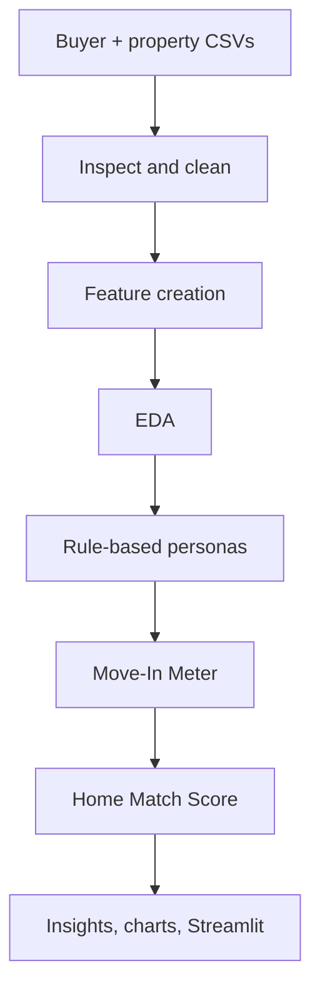

# Gen-Z Buyer Intelligence for Residential Builders

Python prototype: buyer personas, Move-In Meter (readiness), Home Match Score (property matching), Streamlit dashboard.

## Run
```
pip install -r requirements.txt
python generate_data.py     # (optional) regenerate synthetic raw data
python run_analysis.py      # cleans data, writes data/*_clean.csv, top-3 matches and outputs/charts/*.png
streamlit run app.py        # interactive dashboard
```

## Flowchart


## Files
| File | Purpose |
|---|---|
| generate_data.py | Builds the synthetic buyer data and stand-in property data (with deliberate dirt) |
| pipeline.py | All logic: cleaning, features, personas, Move-In Meter, Home Match Score, demand-vs-inventory |
| run_analysis.py | Runs pipeline, saves cleaned CSVs and 11 EDA/insight charts |
| app.py | Streamlit interface |
| data_dictionary.md | Every field and scoring rule |

## Using the real Kaggle property dataset
Rename its columns to: property_id, project_name, city, locality, property_type, bhk, area_sqft, price, possession_status, possession_months, amenities. Save as `data/properties_raw.csv`. Record the dataset title, link, creator and licence in your report, as the proposal's ethics section commits.

## Two views in the app
- **Buyer view:** buyer enters money, home and lifestyle details; sees live Move-In Meter, persona, top-3 homes, a what-if simulator, and can share the anonymous profile with the builder (saved to `data/live_leads.csv`).
- **Builder view:** *Live leads* tab (captured from buyers, ranked by readiness) plus the analytics dashboard on the synthetic lead base.
